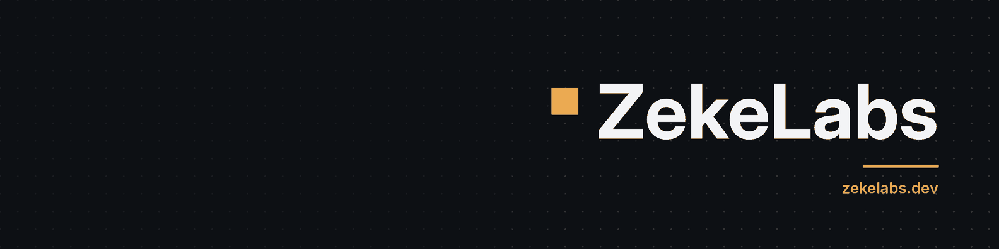
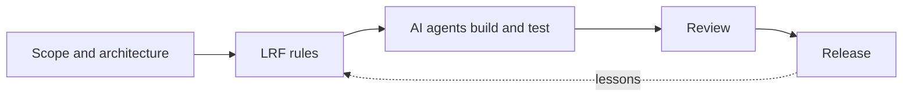

  

<h3 align="center">AI-built software, in real use.</h3>

  <a href="https://zekelabs.dev">zekelabs.dev</a>

---

| Build | Status | What it is |
|---|---|---|
| **Legacy RPG restoration** |  | A 2000s online RPG running again on a current Windows PC with no source code: client patched in place, text recovered, interface redrawn with AI |
| **Kalsys** |  | MCP server that gives AI clients one memory across sessions and projects. Each session opens on the right context; every change is checked |
| **Fateweaver** |  | Free AION 2 overlay for Windows: DPS meter, party HP, PvP tracking, timers and cube alerts. [Releases](https://github.com/ZekeLabs/fateweaver-releases) |
| **The Digital Novice** |  | Plain-English scam and fraud newsletter that finds, writes, fact-checks, illustrates and sends each issue itself, and skips a day rather than send a bad one |
| **Utility billing system** |  | Invoicing, payments and a customer portal for a utility with 200+ accounts. Private |

## How it's built

Every build runs under the Layered Reasoning Framework (LRF): the rules, open items and session history live in Kalsys, so each agent session starts with the right context and every change is checked before it ships.

---

Code is private. Write-ups and demos at <a href="https://zekelabs.dev">zekelabs.dev</a>.
